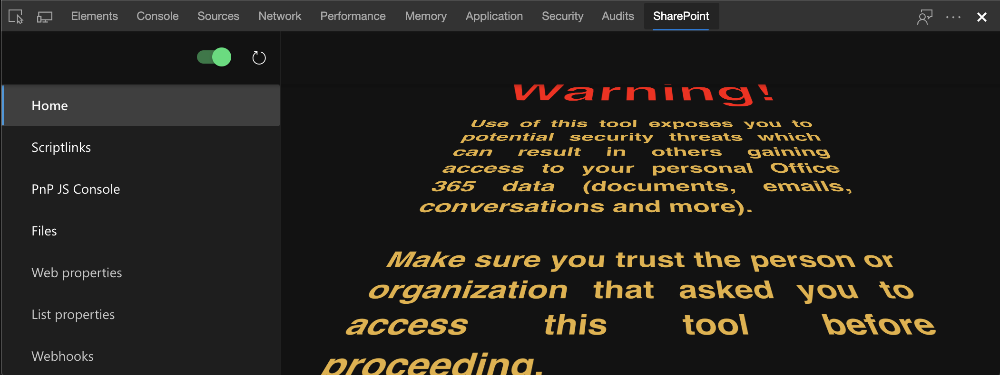
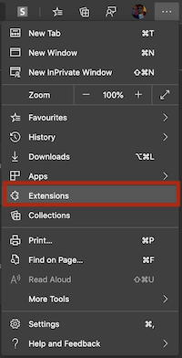
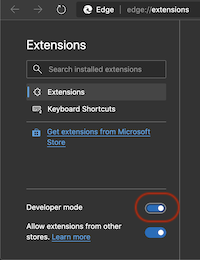
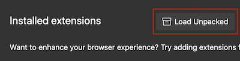
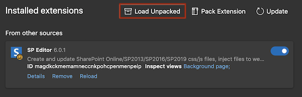
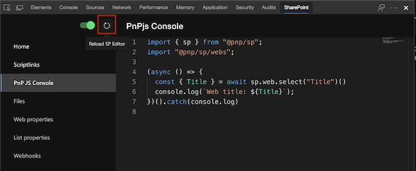
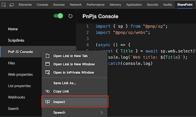

# SP Editor
SP Editor is a developer tool extension for SharePoint available on [Chrome](https://chrome.google.com/webstore/detail/sp-editor/ecblfcmjnbbgaojblcpmjoamegpbodhd) and [Microsoft Edge](https://microsoftedge.microsoft.com/addons/detail/sp-editor/affnnhcbfmcbbdlcadgkdbfafigmjdkk).



If you want to chip in by porting features or even creating new ones, here is a guide how to get started contributing.

### Running locally with watch mode
```powershell
git clone https://github.com/pnp/sp-editor.git # clone the project
cd sp-editor # go to the folder
code . # open vscode
npm i # install dependencies
npm run build # to build everything before starting to developing
npm start # build and start watch mode
```
When Watch is running, open Microsoft Edge and select Extensions from the menu



Enable Developer Mode



Load Unpacked Extension, select the **build** folder of the project



If all good, the local build extension will show up



Now you can open a SharePoint site, open devtools and select SharePoint tab. The extension updates it self on file changes. If it does not, press the reload button to reload extension after making code changes.



To inspect the Extension, you can open the extension devtool by right clicking and selecting **Inspect** and you can see the dom/console/sources/etc of the extension.



### AI Assistant (optional)

The AI Assistant runs through an AI CLI on your machine, connected to the extension by a small native messaging bridge. You need **one** of these CLIs:

```bash
# GitHub Copilot CLI (requires a Copilot subscription)
npm install -g @github/copilot
copilot login

# or Claude Code (requires a Claude subscription or an Anthropic API key)
npm install -g @anthropic-ai/claude-code
claude auth login
```

Then install and register the bridge:

```bash
npm install -g @sp-editor/native-bridge
sp-editor-bridge install
```

After running `sp-editor-bridge install`, reload the extension in the browser and the AI Assistant panel will be able to connect. Choose the provider by picking a model in the panel's model picker.

When developing with an unpacked build, register the bridge for your local extension ID instead: `sp-editor-bridge install --extension-id <your-unpacked-id>`. Run plain `sp-editor-bridge install` again to switch back to the store extension.

For what the bridge and the AI can and cannot do, and where your data goes, see [Security & privacy](packages/native-bridge/README.md#security--privacy).
### Usage statistics

SP Editor sends anonymous usage statistics to Google Analytics, to see which features are used and what to improve:

- **Events:** opening the popup or DevTools, opening a feature, clicking a popup link, and using the AI Assistant (the page it was used on and the provider: GitHub Copilot or Claude Code).
- **Context:** extension version, browser and version, operating system, language, screen size, and country. The country comes from your time zone setting, not from your IP address.
- **Identifiers:** a random ID created at install, not linked to any account.

Never sent: your name or email, SharePoint URLs or tenant names, code, queries, request bodies, AI prompts or answers, or any other content.

To turn it off, open the navigation menu and switch off **Send anonymous usage statistics**. This also deletes the random ID. Builds loaded unpacked (for development) send nothing.

For developers: in an unpacked build, `localStorage.setItem('sp_analytics_debug', '1')` in the extension's DevTools console sends each event to Google's validation endpoint instead and logs the result. Nothing is reported. Use `'send'` instead of `'1'` to really send events from the unpacked build (they show in GA Realtime) and log them. Remove it with `localStorage.removeItem('sp_analytics_debug')`.
